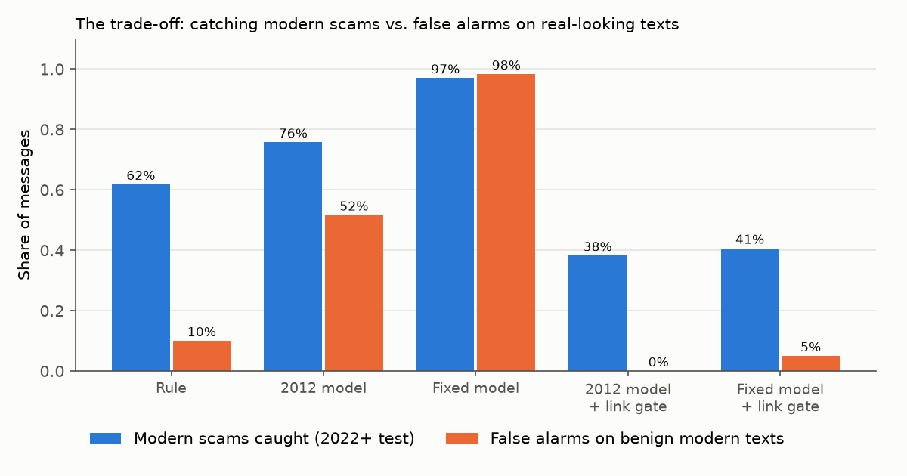

# Scam Drift

**Track:** Finance
**Team:** TEAM_NAMES_PLACEHOLDER

## The problem
Scam texts take money from older people. A grandparent (or the family member who sets up their phone) needs one decision: *should I warn before this link is tapped?* Many simple scam filters are built on the classic 2012 UCI SMS Spam Collection. We ask: **does a filter trained on 2012 SMS spam still catch 2020s smishing, which scam types slip through, and can we fix it without flooding the grandparent with false alarms on genuine modern texts** (bank one-time codes, delivery updates, pharmacy and doctor reminders)?

## What we built
A leakage-safe experiment and a demo:
- `src/scam_drift.py` runs the whole pipeline (seeded, about 21 s on CPU) and writes `results/metrics.json`, tables, figures and two models.
- `scam_drift.ipynb` walks through it step by step (Colab-compatible, executed with outputs).
- `app.py` is a Gradio demo: paste a text, compare the 2012 model with the fixed model, get a plain-language warning and the top 5 words that pushed the score toward "scam".

## What we added
We started from the suggested project **4.2.1 Scam text filter** (TF-IDF + logistic regression on SMS spam). We added:
- **Our own user:** an elderly grandparent; a missed scam costs 5x a false alarm when we choose the warning threshold.
- **Our own data:** 33,869 real 2020s smishing reports (IMC 2025 "Fishing for Smishing", 69 languages, 8 scam types) and a 100-message **synthetic benign-twins** test set (60 genuine-style modern notifications + 40 look-alike scams, written with AI assistance, never used for training).
- **Our own question:** dataset drift. We split the modern data **by time** and check for dataset shortcuts.

## How it works
**Data.** UCI SMS Spam Collection (5,574 messages; 5,135 after removing duplicates; stratified 80/20 split). IMC25 smishing reports: 22,073 English rows, 15,255 unique after normalisation. The IMC25 `time` field is the raw screenshot timestamp (often "Today 8:15 AM"), so only rows that show a year can be dated. **Time split:** English scams dated 2015-2021 (1,809) may be used for training; scams dated 2022-2024 (1,080) are the untouched modern test; 12,365 undated scams are never trained on. Every text goes through the **same normaliser**: links, phones, emails, money, dates and numbers become shared tokens (`tok_url`, `tok_phone`, ...), IMC25 placeholders map onto the same tokens, named-entity tags are deleted, then lowercase.

**Model.** TF-IDF word 1-2 grams + logistic regression (main model; a char 2-5 gram variant is also reported). *Model 2012* is trained on UCI only. *Fixed model* adds the 2015-2021 English scams. We have no real modern genuine texts, so the negatives are still UCI ham (main limitation). Thresholds come from 5-fold out-of-fold predictions on training data only, minimising 5 x missed scams + 1 x false alarms. Explanations = coefficient x tf-idf value.

## Results
All numbers are copied from `results/metrics.json`. Modern tests contain only scams, so precision is undefined there; false alarms are measured on UCI test ham and on the benign twins.

| Model (threshold) | UCI test P / R / F1 | False alarms, UCI ham | Modern scams caught, 2022+ test (n=1,080) | False alarms, benign twins (n=60) |
|---|---|---|---|---|
| Always "not scam" | undefined / 0.0 / 0.0 | 0.0 | 0.0 | 0.0 |
| Rule: link or urgency word | 0.8364 / 0.371 / 0.514 | 0.01 | 0.6185 | 0.1 |
| Model 2012 (0.32) | 0.936 / 0.9435 / 0.9398 | 0.0089 | 0.7574 | 0.5167 |
| Fixed model (0.20) | 0.7101 / 0.9677 / 0.8191 | 0.0543 | 0.9704 | 0.9833 |
| Fixed model + link gate | 0.9048 / 0.1532 / 0.2621 | 0.0022 | 0.4065 | 0.05 |



**Findings.**
1. **Drift is real.** Model 2012 catches 0.9435 of 2012 spam but only 0.7574 of 2022+ scams (0.7854 of 12,365 undated scams). It misses most "wrong number" scams (recall 0.0833, n=24) and "hey mum/dad" scams (0.0, n=4), which open with friendly small talk.
2. **The "fix" catches more scams but floods the user.** Adding 2015-2021 scams lifts 2022+ recall to 0.9704, but the fixed model flags 59 of 60 genuine-style notifications (false-alarm rate 0.9833; 0.8833 even at threshold 0.5). It learned "formal notification = scam", because every formal message it saw was a scam. Without real modern genuine texts, this fix is not safe to ship.
3. **The rule baseline is not beaten on every axis.** Both models beat the rule on UCI F1, but on the benign twins the rule raises far fewer false alarms (0.1) than either model.
4. **Language gap.** On 8,870 non-English scams, Model 2012 catches 0.4933 from the raw text and 0.6906 from the English translation.
5. **Shortcut check.** After normalisation, a classifier still separates UCI spam from IMC25 scams with ROC AUC 0.9895. Top tokens include `tok_date` (IMC25's anonymiser tagged dates more aggressively than our regex) and 2012 texting words (`txt`, `u`, `ringtone`). Part of the measured gap is dataset style, not only scam drift.

**Where it fails and why.** Missed scams are mostly conversational openers ("How are you doing", "Hi mum I'm texting you off a friends phone"), a homoglyph message written with Cyrillic letters, and reports that are not clearly scams ("Fuck off", "Thank you"), which shows label noise in user reports. False alarms are formal, money-related or code-related genuine texts, and links: the normaliser hides the domain, so an official link looks the same as a scam link. Details: [docs/RESULTS_DETAIL.md](docs/RESULTS_DETAIL.md).

## What we'd do next
- Collect real modern genuine texts (consented, anonymised the same way) as negatives; this is the missing piece for a safe fix.
- Keep the link domain (official vs. look-alike) as a feature instead of hiding it.
- Handle conversation-style scams with multi-message context, and homoglyph normalisation.
- Train multilingual, and test with older users how warnings should read.

## How to run
```bash
python -m venv .venv && .venv/Scripts/pip install -r requirements.txt   # use .venv/bin/pip on macOS/Linux
python src/scam_drift.py      # full pipeline, about 21 s; writes results/, figures/, models/
python app.py                 # Gradio demo at the local URL it prints
```
Data: put `SMSSpamCollection` and `imc25_smishing.csv` in `data/raw/` (the notebook's first cell downloads both).

## Sources
- UCI SMS Spam Collection, Almeida & Gomez Hidalgo (2011): https://archive.ics.uci.edu/dataset/228/sms+spam+collection (CC BY 4.0)
- "Fishing for Smishing", Agarwal, Papasavva, Suarez-Tangil, Vasek, IMC 2025: https://github.com/reportsmishing/Smishing-Dataset-IMC25 , https://doi.org/10.1145/3730567.3764431 (CC BY 4.0)
- Synthetic benign twins (`data/benign_twins.csv`): written with AI assistance for this project; test only.
- Libraries: scikit-learn https://scikit-learn.org , pandas https://pandas.pydata.org , NumPy https://numpy.org , matplotlib https://matplotlib.org , Gradio https://gradio.app , joblib https://joblib.readthedocs.io , Jupyter/nbconvert https://jupyter.org
- AI tools: Claude (Anthropic) via Claude Code https://claude.com/claude-code (code, analysis, write-up drafts); ChatGPT (OpenAI) https://chatgpt.com and Gemini (Google) https://gemini.google.com (idea critique).
- Full list: [CREDITS.md](CREDITS.md)

This project is a prototype and is not financial advice.
