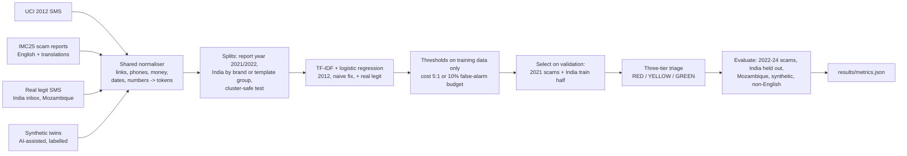

# Scam Drift

**Track:** Finance
**Team:** Kartikeya Lathi and William Lu (Jordan High School)

This project is a prototype and is not financial advice.

**Post-deadline demo.** The judged entry is git `main` at `01abbc9`. This branch is for the demo and portfolio.

## Check a text

Install `requirements.txt` and `requirements-neural.txt`, then run `python server.py` and open `http://127.0.0.1:8000`. Keep the saved models in `models/`. The homepage incorporates William’s study frontend and Lenis scrolling from `gh-pages` commit `7e834e7`. The Inbox Flood is available at `/lab/`. FastAPI serves both checkers through `/api/check`. The homepage loads parts of the 3D study and its scrolling from a CDN. The Inbox Flood uses local scripts and fonts.

Set `SCAM_DRIFT_REQUIRE_CONTEXT=1` for deployment so startup fails if the fine-tuned model cannot load. A readable English smoke-test message should return `context_model: bert-tiny-sms-v1` from `/api/check`.

The full checker still misses some financial impersonation messages, including a tested portfolio sign-off request without a visible URL. The [finance regression report](results/finance_regression.json) records the misses, legitimate controls, and load test. Run `python tools/finance_regression.py --url http://127.0.0.1:8000` against a running server to replay the cases.

Scam Drift helps someone pause before replying to an unexpected text, paying a fee, or sharing a one-time code. Paste the text and remove any names, codes, or account details that you do not want to share with the checker server. The server reads the text in memory. The site shows the warning level, what triggered it, what to do next, and highlighted phrases. It never follows links or contacts a sender.

- **High risk.** Stop and verify through a number or app you already trust.
- **Be careful.** Pause. The text contains a warning sign or needs another check.
- **No warning signs found.** Verify any request for money or private information independently.

**Already acted?** Open the recovery guide from the checker or a verdict. Pick whether you opened a link, shared a code or password, or sent money. The choice stays in the browser. The guide links to the [U.S. FTC recovery resource](https://consumer.ftc.gov/articles/what-do-if-you-were-scammed).

The checker combines a saved English-first classifier with written rules for code and password requests, gift cards, upfront job fees, rental deposits, QR-payment requests, new-number stories, and personal-safety concerns. It can flag a request for a second check when the text is too short or may be outside English. It cannot authenticate a sender, determine whether a link is safe, or see the preceding conversation.

## The inbox flood

Scroll through the same historical experiments as data-driven message flows. Scam recall and legitimate-text false alarms have separate denominators. The message bubbles illustrate those test rates. The site reads each rate and its sample size from `/api/story`. The story uses Three.js, GSAP ScrollTrigger and Lenis with a static version for reduced motion.

See the [front-end reference audit](docs/FRONTEND_REFERENCES.md) for the layout and motion sources and the scope of each REA capture.

## Reproduce the post-deadline checks

```bash
python tools/api_parity.py
python tools/checker_stress.py
python tools/checker_stress.py --corpus
python tools/checker_stress.py --url http://127.0.0.1:8000
```

The local regression run passed 150 targeted variants and 19 request and input-edge checks. A loopback run passed all 512 requests with eight workers. Median latency was 41.9 ms and p95 latency was 274.7 ms, including long inputs in the request mix. A 20,000-character text with distinct words took 188.1 ms in a separate in-process check. These measurements describe the test machine and workload.

| Historical test set | Previous checker warned | Updated checker warned | Updated “needs another check” subset |
|---|---:|---:|---:|
| Dated English scam reports | 715 / 1,080 | 719 / 1,080 | 12 |
| Dated English scam reports with recurring training templates removed | 575 / 927 | 579 / 927 | 12 |
| Other-language scam reports | 1,433 / 8,866 | 2,996 / 8,866 | 1,515 |
| Held-out legitimate Indian business texts | 141 / 608 | 153 / 608 | 10 |
| Legitimate texts from Mozambique | 35 / 1,608 | 93 / 1,608 | 58 |

These counts include both RED and YELLOW. The previous-checker column reruns the prior web warning rules with the saved model. The archived research tables below use a separate historical evaluation. Uncertainty is a prompt for human review. The corpus results cannot establish production accuracy or a 99.999% guarantee.


## Original research
People reported $470 million in losses to text-message scams in 2024 (FTC). Our user is an English-reading grandparent and the family member who set up their phone. The moment of use: a text claims to come from a bank, courier or government office; before tapping the link, the grandparent pastes it into the checker and gets RED, YELLOW or GREEN. Many simple filters still learn from 2012 UCI SMS data. Do they catch today's scams, whom do they fail, and can we fix them without false alarms on genuine modern texts? The tool currently fails non-English readers (see "every group" below).

## Original warning policy
- `src/triage.py`, a warn-only three-tier check. **RED** "Likely scam - do not tap, do not reply": the model flags and the text has a link or phone number. **YELLOW** "Ask family before replying": the model flags without one, or a rule fires (asks for a code, PIN or password; "hi mum", "new number" or "wrong number" opener). **GREEN** "No warning signs found", never "safe".
- `app.py`, a Gradio demo that shows the verdict and its reasons; `src/scam_drift.py`, the seeded experiment (125.4 s on CPU); `scam_drift.ipynb`, the walk-through.
- Real example (2022-24 report): "Apple: Your Apple Pay has been suspended due to unusual activity. Please visit: `<URL>` ..." -> **RED**; top words "suspended", "[a web link]".

## What we added
We started from suggested project **4.2.1 Scam text filter**. The organizers' sample ScamCheck tested 40 hand-written texts. Unlike it, we:
- test thousands of real reported scams (IMC 2025 "Fishing for Smishing") across report years, scam types and languages: 1,080 dated 2022-24, 12,364 undated, 8,866 non-English;
- show the naive fix's (retrain on new scams) false-alarm failure on real modern legitimate SMS: an Indian inbox (1,206) and Mozambique (1,608, Portuguese, never trained on);
- evaluate a three-tier warn-only design. **Disclosure:** the tiers, the YELLOW rules and the strict-threshold rule were designed after we saw the v1 results (post-hoc), and the India and Mozambique legit sets were looked at during exploration. Only the model and its threshold rule were then chosen on validation data. Treat the triage numbers as optimistic.

## How it works
One normaliser turns links, phones, money, dates and numbers into shared tokens. Models: TF-IDF n-grams + logistic regression. Training: UCI 2012, scams reported up to 2021, and half of the India inbox (split by brand or template group; 0 brands on both sides). Test: 2022-24 scams, the other India half, Mozambique, and 30 synthetic legitimate texts (written with AI assistance). The model (`char_fix_plus_real_ham`) and its threshold rule were chosen on validation data only (2021 scams, India training texts). Its threshold, 0.94, aimed at 10% false alarms on India training texts; on held-out India texts the model alone flags 20.4%, about double.

## Historical results


| Model | UCI 2012 test: precision / recall | 2022-24 scams warned (n=1,080) | India legit warned, held-out groups (n=608, 95% CI) | Mozambique legit warned (n=1,608) | Synthetic legit warned (n=30, 95% CI) |
|---|---|---|---|---|---|
| Always "not scam" | undefined / 0% | 0% | 0% | 0% | 0% |
| Rule: link only | 86.4% / 15.3% | 40.7% | 47.4% (43.4-51.3) | 2.0% | 6.7% (1.9-21.3) |
| 2012 model | 93.6% / 94.4% | 75.7% | 82.2% (79.0-85.1) | 39.4% | 36.7% (21.9-54.5) |
| Naive fix (+ new scams) | 75.3% / 96.0% | 96.6% | 99.5% (98.6-99.8) | 62.5% | 100% (88.7-100) |
| **Original prototype triage** (RED or YELLOW) | 96.8% / 73.4% | 65.7% | 22.9% (19.7-26.4) | 2.2% | 16.7% (7.3-33.6) |

- **Precision where it matters.** Modern test sets hold only scams or only legit texts, so we estimate precision at an assumed 5% scam rate (not measured), against held-out India texts: prototype triage 13.1%, 2012 model 4.6%, naive fix 4.9%, link-only rule 4.3%. Even our best option gives about 7 false alarms per real warning.
- **Trade-off against the 2012 model:** the triage warns on fewer new scams (65.7% vs 75.7%) but on far fewer held-out India legit texts (22.9% vs 82.2%).
- **Against the link-only rule:** the triage warns on more new scams (65.7% vs 40.7%) and on fewer India legit texts (22.9% vs 47.4%). It does not beat the rule on Mozambique (2.2% vs 2.0%) or synthetic legit texts (16.7% vs 6.7%).
- **Fix ingredients.** Real modern legit texts in training lower India false alarms from 99.5% to 65.6%; the strict threshold lowers them further to 22.9%, still about 1 in 4 legit texts.
- **A step, not a slide.** The 2012 model catches 94.4% of 2012 test spam (92.1% without near-copies), then 74.5-83.5% per report year 2017-2023: a one-time era shift, not a yearly decline. Details, template-safe numbers and the learning curve: [docs/RESULTS_DETAIL.md](docs/RESULTS_DETAIL.md).

**Does it work equally well for every group?** No (prototype triage, 2022-24 scams). Per language: it warns on 16.1% of raw non-English scams vs 68.3% when we score the dataset's English translation (an "oracle": the best case if translation were perfect). Per scam type: "wrong number" 25.0% (n=24) vs banking 84.4% (n=468). Per length: under 80 characters 30.3% (n=152). Weakest: non-English readers without translation.

**Where it fails.** Five real 2022-24 reports left GREEN, picked by a fixed rule (the shortest text of 40+ characters from each of the 5 scam types with the most misses): "Tap to reset your Instagram password: `<URL>`"; "Collect request from PAYU for `<DATE_TIME>`"; "Breaking: USA Says Goodbye to Dr Oz:`<URL>`"; "`<URL>` has been reported as a malware site."; "Dear IEC Holder, It is mandatory to update your IEC before `<DATE_TIME>`...". Several read like genuine notices, so some may be label noise (our assumption, not checked). Two false alarms (synthetic, written with AI assistance) -> YELLOW: "Your copay for today's pickup is $10.00. Pay at the counter."; "Your parcel will arrive tomorrow between 10am and 2pm. No action needed."

**What we learned.** More scam data does not fix an old filter; modern legitimate texts and a false-alarm budget do more, but not enough. One recall number hides the cost: measure false alarms on real texts from the same era. Time splits leak: templates recur (153 of 1,080 test rows).

## What we'd do next
- Collect consented, anonymised legitimate texts from many inboxes and countries.
- Add on-device translation for non-English readers, then test the warning wording with older non-native speakers.
- Add multi-message context (many misses are short openers or fragments).

## Sources
- UCI SMS Spam Collection (CC BY 4.0): https://archive.ics.uci.edu/dataset/228/sms+spam+collection
- "Fishing for Smishing", IMC 2025 (CC BY 4.0): https://github.com/reportsmishing/Smishing-Dataset-IMC25
- India SMS inbox sample (MIT): https://huggingface.co/datasets/gandharvbakshi/SMS-dataset-sample-10k
- MOZ-Smishing (OpenRAIL-M): https://huggingface.co/datasets/MOZNLP/MOZ-Smishing
- FTC "Top text scams of 2024": https://www.ftc.gov/news-events/data-visualizations/data-spotlight/2025/04/top-text-scams-2024
- Full list with licences: [CREDITS.md](CREDITS.md). Full tables: [docs/RESULTS_DETAIL.md](docs/RESULTS_DETAIL.md).

## How to run
```bash
python -m venv .venv && .venv/Scripts/pip install -r requirements.txt   # .venv/bin/pip on macOS/Linux
python src/scam_drift.py      # full seeded pipeline (about 2 min on CPU); writes results/, figures/, models/
python src/triage.py          # prototype triage on example texts
python server.py              # post-deadline website and JSON API
python app.py                 # original Gradio demo
jupyter nbconvert --to notebook --execute --inplace scam_drift.ipynb
```
By default the notebook loads the saved `results/metrics.json` and re-scores the saved model live. Set `RUN_PIPELINE = True` in its section 1 to rerun the whole seeded pipeline (about 2 min on CPU); the live check then reproduces `metrics.json`. In Colab, run the clone cell at the top first.
Put `SMSSpamCollection` and `imc25_smishing.csv` in `data/raw/` (the notebook's first cell downloads both and checks their SHA-256). The pipeline downloads the India and Mozambique sets from pinned Hugging Face revisions; they are not stored in this repository because the texts contain first names.

## Repository map
| Path | What it is |
|---|---|
| `server.py` | FastAPI, request bounds, and same-origin text checker |
| `src/web_triage.py` | Post-deadline warning policy, input quality, and evidence |
| `web/` | Buildless checker and API-driven Three.js scroll story |
| `tools/checker_stress.py` | Targeted, API transport, concurrent and corpus regression checks |
| `src/scam_drift.py` | Pipeline: data, splits, models, thresholds, all v1 and v2 analyses, figures, `results/metrics.json` |
| `src/triage.py` | Prototype three-tier triage, `triage(text)` |
| `scam_drift.ipynb` | Executed walk-through of every v2 analysis |
| `app.py` | Gradio demo: triage verdict, reasons, 2012-filter comparison |
| `results/` | `metrics.json` (source of every number) and CSV tables |
| `figures/` | Charts used here and in the results doc (`lead_chart_v2.png` = v2 lead chart) |
| `models/` | Saved models; `model_shipped.joblib`, `shipped_config.json` |
| `data/benign_twins.csv` | 100 synthetic texts (written with AI assistance), test and stress set |
| `docs/RESULTS_DETAIL.md` | Full results (generated by `tools/write_results_detail.py`) |
| `docs/PLAN.md`, `docs/V2_SPEC.md`, `docs/CONSULT_LOG.md` | Plan, v2 spec, AI consultation log |
| `CREDITS.md` | Datasets, libraries and AI tools with licences |

## AI tools we used
- **Claude (Anthropic) via Claude Code** wrote much of the code under the team's direction and helped plan and audit the method. The team reviewed the code, re-ran every result and can explain every part.
- **ChatGPT (OpenAI), Gemini (Google) and Claude chat** acted as critics of the idea, the method and the results. Their advice and what we did with it: [docs/CONSULT_LOG.md](docs/CONSULT_LOG.md).
- The synthetic legitimate and scam twins were written with AI assistance and are labelled synthetic everywhere.

## Pipeline


This project is a prototype and is not financial advice.
