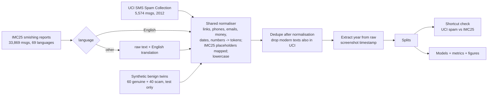
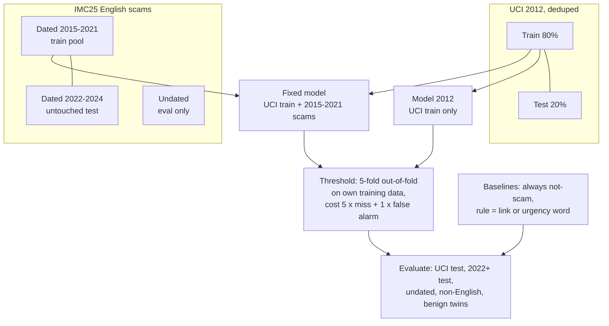
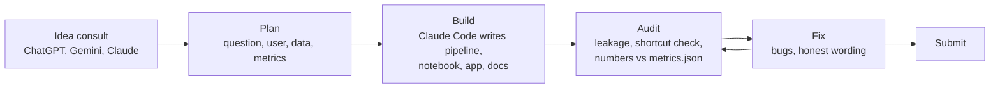

# Scam Drift: implementation plan

Hackathon: Veritas AI International High School Hackathon, AI + Finance track. Deadline: today 11:59 PM ET (extension approved by the organiser).

## 1. Data pipeline

## 2. Experiment design

Rules: no test set is used for any choice; benign twins are never trained on; hyperparameters are fixed in advance (no search).

## 3. Agentic build loop

## 4. Timeline to deadline

All times are Eastern Time (ET). "done" items have file timestamps as evidence; the other items are planned.

```mermaid
gantt
    title Scam Drift build (deadline 23:59 ET)
    dateFormat HH:mm
    axisFormat %H:%M
    section Build
    Datasets downloaded                 :done, b0, 18:00, 5m
    Pipeline, twins, models, figures    :done, b1, 18:05, 15m
    Notebook, app, write-up             :done, b2, 18:15, 15m
    section Check and submit (planned)
    Audit and fixes                     :c1, 18:30, 60m
    Demo video and submission           :c2, 19:30, 120m
    Buffer before deadline              :c3, 21:30, 149m
```

The idea consult with ChatGPT, Gemini and Claude happened before the build; its exact times were not recorded.
