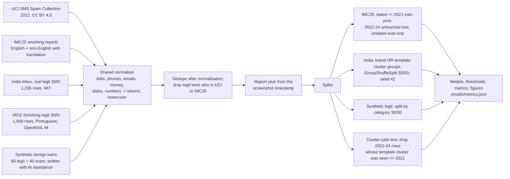
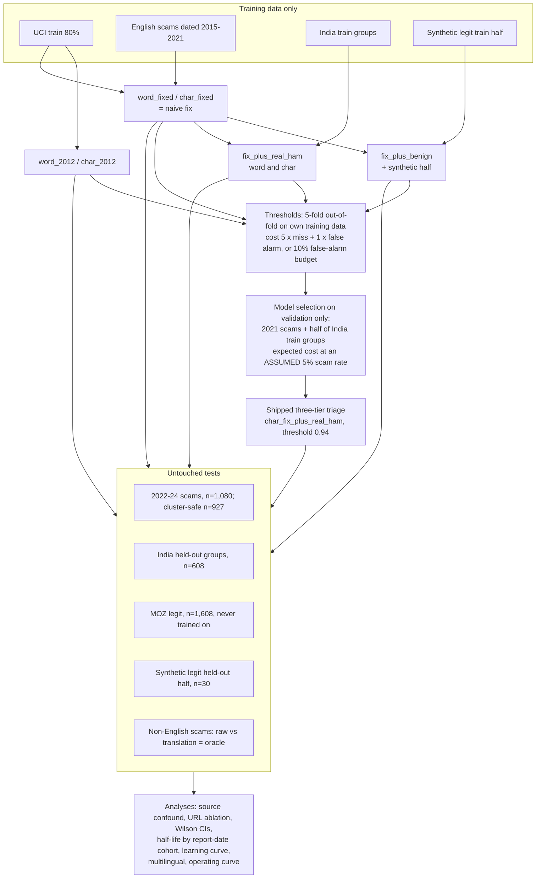
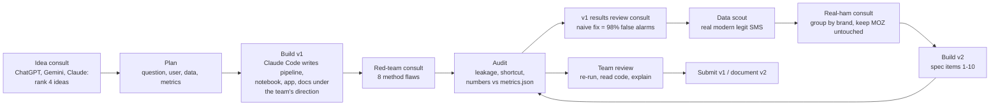
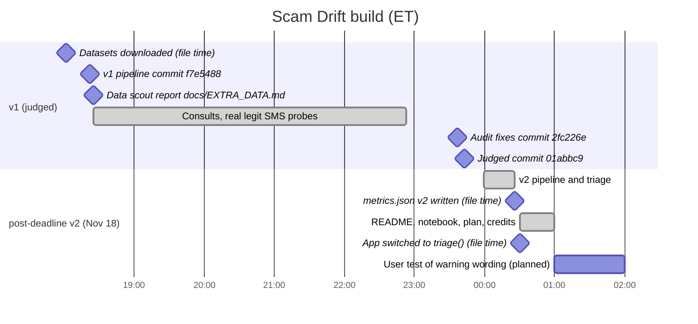

# Scam Drift: implementation plan

Hackathon: Veritas AI International High School Hackathon 2026, AI + Finance track. The submission closed at 11:59 PM ET on Nov 17. The judged entry is git `main` at commit `01abbc9`; it does not change. Sections 1-4 below describe the **post-deadline v2 (Nov 18)** branch. The v1 plan is kept in section 5 for the record.

Every number in the project documents comes from `results/metrics.json`, written by `src/scam_drift.py`.

## 1. Data pipeline (v2)

The India and MOZ texts contain first names. The pipeline downloads them from pinned Hugging Face revisions into the git-ignored `data/raw/extra/`. Only aggregates are written to `results/` and `figures/`.

## 2. Experiment design (v2)

Rules: no test set is used for any choice. MOZ is never trained on. The tiers, the rules and the strict threshold were designed after the v1 results were seen (post-hoc), then frozen and evaluated.

## 3. Agentic build loop with AI-consult iterations

Each consult and what we took from it: `docs/CONSULT_LOG.md`.

## 4. Timeline

All times are Eastern Time (ET). Each milestone has evidence: a git commit time or a file modification time. Bars between milestones show work periods; their start times are approximate. The idea consult happened before 18:00 on Nov 17; its exact time was not recorded.

"done" bars are finished; the last bar is planned, not done.

## 5. v1 plan (judged entry, for the record)

v1 trained `word_2012` / `char_2012` on UCI and the naive fix on UCI + 2015-2021 scams, chose thresholds by 5-fold out-of-fold cost (5:1), and evaluated on UCI test, 2022+ scams, undated scams, non-English scams and the benign twins. Its baselines were "always not scam" and "link or urgency word". Its results are Part B of `docs/RESULTS_DETAIL.md`.
